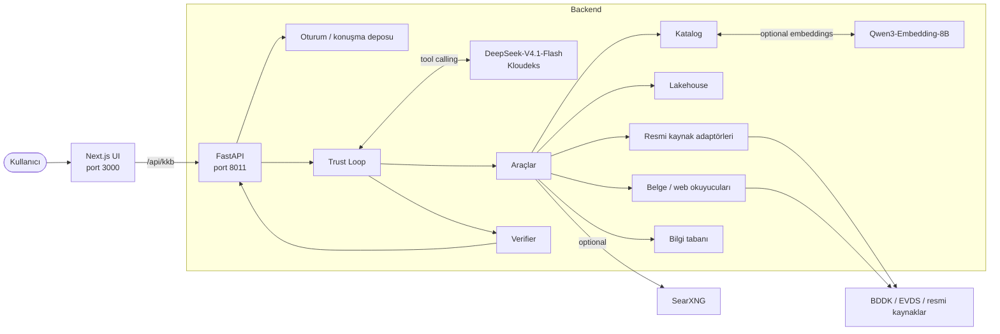
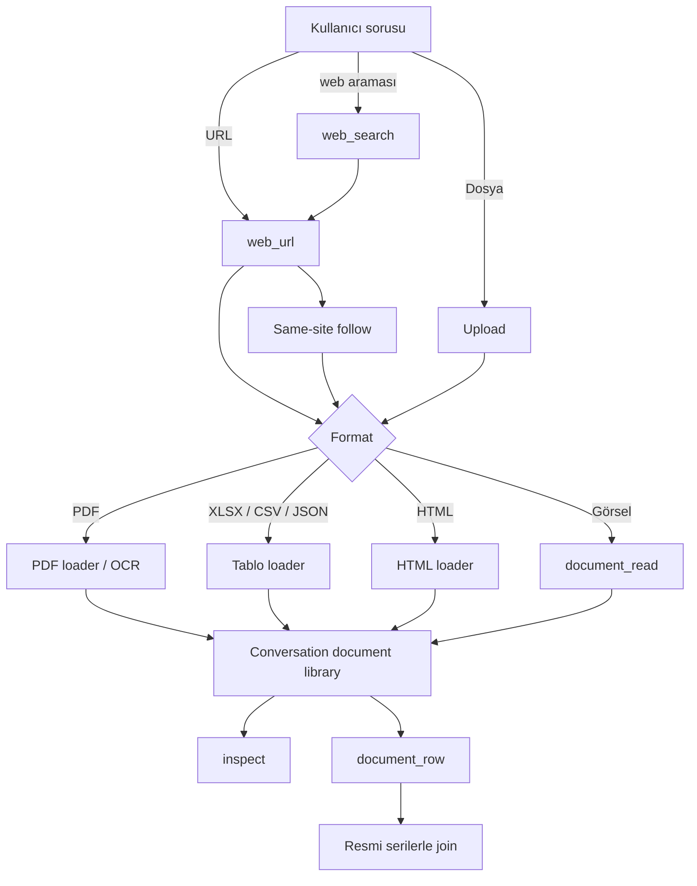
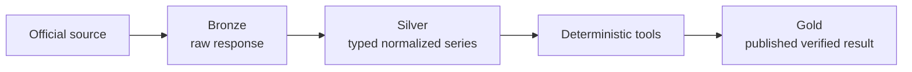

# DataTrio — KKB Agentic Data Analytics

DataTrio; BDDK, TCMB/EVDS, TÜİK, web sayfaları ve kullanıcı belgeleri üzerinde Türkçe doğal dil ile çalışan, kanıt zinciri taşıyan agentic finansal veri analiz sistemidir.

Model hangi aracı ne zaman çağıracağına kendisi karar verir; ancak finansal hesaplamalar model tarafından yapılmaz. Sayısal işlemler deterministik Python araçlarında gerçekleştirilir ve cevapta kullanılan değerler kullanıcıya gitmeden önce kaynak, dönem, birim ve sonuç kimliği açısından doğrulanır.

**Runtime model:** Kloudeks üzerinden `deepseek-ai/DeepSeek-V4.1-Flash`  
**Embedding:** `Qwen3-Embedding-8B` ile opsiyonel hibrit katalog araması  
**Backend:** Python 3.12 · FastAPI · DuckDB / Parquet  
**Frontend:** Next.js · Node.js 22  
**Veri katmanı:** Bronze / Silver / Gold lakehouse  
**Ana kaynaklar:** BDDK · TCMB/EVDS · TÜİK · BIST · web/PDF/XLSX/CSV/görsel belgeler

---

## İçindekiler

1. [Jüri / Fresh Clone Quickstart](#1-jüri--fresh-clone-quickstart)
2. [Opsiyonel özellikler](#2-opsiyonel-özellikler)
3. [Genel mimari](#3-genel-mimari)
4. [Agentic karar alma ve görev işleme](#4-agentic-karar-alma-ve-görev-işleme)
5. [Doküman ve web okuma](#5-doküman-ve-web-okuma)
6. [Modüler kod yapısı](#6-modüler-kod-yapısı)
7. [Katalog, lakehouse ve bilgi tabanı](#7-katalog-lakehouse-ve-bilgi-tabani)
8. [Doğrulama ve güvenlik](#8-doğrulama-ve-güvenlik)
9. [Testler](#9-testler)
10. [Sorun giderme](#10-sorun-giderme)

---

# 1. Jüri / Fresh Clone Quickstart

Bu bölüm temiz bir bilgisayarda projeyi GitHub'dan klonlayıp çalıştırmak için yeterlidir.

> **Önemli:** `data/processed/` Git'e eklenmez. Bu nedenle fresh clone içinde hazır lakehouse veya katalog vektör dizini bulunmaz. İlk çalıştırmada aşağıdaki veri hazırlama adımı uygulanmalıdır.

## 1.1 Gereksinimler

| Araç | Sürüm / Not |
|---|---|
| Python | 3.12 |
| Node.js | 22 (`.node-version` sağlanır) |
| Git | Güncel sürüm |
| İnternet | BDDK / EVDS veri hazırlama ve resmi kaynak erişimi için |
| Kloudeks erişimi | Agent model çağrıları için |
| Docker | Yalnız `web_search` / SearXNG kullanılacaksa |

SearXNG **zorunlu değildir**. Kullanılmazsa yalnızca `web_search` aracı devre dışı kalır.

Doğrudan URL okuma (`web_url`), PDF/XLSX/CSV okuma, resmi BDDK/EVDS edinimi ve yüklenen belgeler SearXNG gerektirmez.

---

## 1.2 Kodu alın ve bağımlılıkları kurun

### macOS / Linux

```bash
git clone https://github.com/cagatayeroglu/KKB-DataTrio.git
cd KKB-DataTrio

python3.12 -m venv .venv
source .venv/bin/activate

python -m pip install -e '.[dev]'

cd web
npm ci --ignore-scripts --no-audit --no-fund
cd ..
```

### Windows PowerShell

```powershell
git clone https://github.com/cagatayeroglu/KKB-DataTrio.git
cd KKB-DataTrio

py -3.12 -m venv .venv
.\.venv\Scripts\Activate.ps1

python -m pip install -e ".[dev]"

cd web
npm ci --ignore-scripts --no-audit --no-fund
cd ..
```

---

## 1.3 Ortam dosyasını hazırlayın

```bash
cp .env.example .env
```

Windows:

```powershell
Copy-Item .env.example .env
```

`.env` dosyasında minimum olarak aşağıdaki Kloudeks değişkenleri doldurulmalıdır:

```text
KLOUDEKS_BASE_URL
KLOUDEKS_API_KEY
KLOUDEKS_PLANNER_MODEL
KLOUDEKS_ROUTER_MODEL
```

Demo ortamında kullanılan agent modeli:

```text
deepseek-ai/DeepSeek-V4.1-Flash
```

Opsiyonel özellikler:

```text
KLOUDEKS_EMBEDDING_MODEL
KLOUDEKS_OCR_MODEL
KLOUDEKS_VISION_MODEL
```

- `KLOUDEKS_EMBEDDING_MODEL`: semantic / hybrid katalog araması için
- `KLOUDEKS_OCR_MODEL`: taranmış PDF ve görseller için OCR
- `KLOUDEKS_VISION_MODEL`: görsel içerik okuma destekleniyorsa

Gerçek anahtarlar hiçbir zaman repository'ye eklenmez.

---

## 1.4 Hazır lakehouse'u oluşturun

Fresh clone içinde `data/processed/lakehouse` bulunmaz.

Backend boş lakehouse ile başlamaz. Bu nedenle ilk çalıştırmada resmi kaynaklardan seed hazırlanmalıdır.

### Önerilen tam hazırlık

Jüri ve demo için bu yol önerilir.

### BDDK

```bash
.venv/bin/python -m kkb_agent.ingest.bddk_monthly_operator prepare \
  --root data/processed/lakehouse \
  --start 2021-01 \
  --end 2026-06 \
  --component TP \
  --component YP \
  --component TOTAL
```

### EVDS / TCMB

```bash
.venv/bin/python -m kkb_agent.ingest.evds_operator prepare \
  --root data/processed/lakehouse \
  --start 2021-01-01 \
  --end 2026-06-30 \
  --series TP.KTF12 \
  --series TP.TUKFIY2025.GENEL \
  --series TP.GENENDEKS.T1 \
  --series TP.KFE.TR \
  --series TP.KTF10 \
  --series TP.KTF101 \
  --series TP.KTF11 \
  --series TP.KTF17 \
  --series TP.KTF17.EUR \
  --series TP.KTF17.USD \
  --series TP.KTF18 \
  --series TP.KTFTUK \
  --series TP.KTFTUK01 \
  --series TP.TUKFIY2025.01 \
  --series TP.TUKFIY2025.02 \
  --series TP.TUKFIY2025.03 \
  --series TP.TUKFIY2025.04 \
  --series TP.TUKFIY2025.05 \
  --series TP.TUKFIY2025.06 \
  --series TP.TUKFIY2025.07 \
  --series TP.TUKFIY2025.08 \
  --series TP.TUKFIY2025.09 \
  --series TP.TUKFIY2025.10 \
  --series TP.TUKFIY2025.11 \
  --series TP.TUKFIY2025.12 \
  --series TP.TUKFIY2025.13
```

Bu işlemler:

- resmi BDDK / EVDS kaynaklarına bağlanır,
- organizer credential gerektirmez,
- public internet erişimi gerektirir,
- Bronze ham kanıtı ve Silver normalize serileri yerel lakehouse'a yazar.

Kaynaklar canlı olduğu için yeniden oluşturulan lakehouse, geliştirme sırasında kullanılan snapshot ile byte-for-byte aynı olmak zorunda değildir. Aynı kaynak ve şemalardan güncel resmi veri kullanılarak yeniden oluşturulur.

### Minimum bootstrap

Yalnız backend'i ayağa kaldırmak için minimum bir BDDK seed'i de yeterlidir:

```bash
.venv/bin/python -m kkb_agent.ingest.bddk_monthly_operator prepare \
  --root data/processed/lakehouse \
  --start 2021-01 \
  --end 2026-06 \
  --component TOTAL
```

Bundan sonra supported fakat henüz yerelde bulunmayan BDDK/EVDS serileri, soru geldiğinde **official acquisition** ile otomatik çekilebilir.

Jüri/demo için ilk sorgularda ağ gecikmesi yaşamamak amacıyla tam hazırlık önerilir.

---

## 1.5 Readiness kontrolü

Model çağrısı yapmadan kurulumu doğrulayın:

```bash
.venv/bin/python -m kkb_agent.api --check \
  --prepared-root data/processed/lakehouse \
  --catalog docs/catalog/prepared_v3.json \
  --env-file .env
```

Beklenen temel çıktı:

```json
{
  "ready": true
}
```

Tam hazırlık yapıldıysa `prepared_identities` alanı da hazırlanmış serileri gösterir.

---

## 1.6 Backend'i başlatın

### macOS / Linux

```bash
PYTHONUTF8=1 \
PYTHONUNBUFFERED=1 \
PYTHONPATH="$PWD/src" \
.venv/bin/python -m kkb_agent.api --serve \
  --enable-model-requests \
  --trust-loop \
  --enable-web-url \
  --prepared-root "$PWD/data/processed/lakehouse" \
  --catalog "$PWD/docs/catalog/prepared_v3.json" \
  --env-file "$PWD/.env" \
  --state-root "$PWD/data/processed/state" \
  --port 8011
```

Başarılı başlangıç örneği:

```json
{
  "ready": true,
  "port": 8011,
  "web_url": true,
  "official_acquisition": true
}
```

### Windows PowerShell

```powershell
$env:PYTHONUTF8='1'
$env:PYTHONUNBUFFERED='1'
$env:PYTHONPATH="$PWD\src"

.\.venv\Scripts\python.exe -m kkb_agent.api --serve `
  --enable-model-requests `
  --trust-loop `
  --enable-web-url `
  --prepared-root "$PWD\data\processed\lakehouse" `
  --catalog "$PWD\docs\catalog\prepared_v3.json" `
  --env-file "$PWD\.env" `
  --state-root "$PWD\data\processed\state" `
  --port 8011
```

---

## 1.7 Frontend'i başlatın

Yeni terminal açın.

### macOS / Linux

```bash
cd web

KKB_LOCAL_API_URL=http://127.0.0.1:8011 \
NEXT_TELEMETRY_DISABLED=1 \
npm run dev
```

### Windows PowerShell

```powershell
cd web

$env:KKB_LOCAL_API_URL='http://127.0.0.1:8011'
$env:NEXT_TELEMETRY_DISABLED='1'

npm run dev
```

Tarayıcı:

```text
http://127.0.0.1:3000
```

Backend terminalinde `"ready": true` görülmeden frontend üzerinden sorgu göndermeyin.

---

# 2. Opsiyonel özellikler

## 2.1 Semantic / hybrid katalog araması

Catalog index **zorunlu değildir**.

Index verilmezse sistem lexical katalog aramasıyla çalışmaya devam eder.

Semantic arama için:

```bash
.venv/bin/python -m kkb_agent.catalog.embedding \
  --catalog docs/catalog/prepared_v3.json \
  --root "$PWD/data/processed/catalog-index/qwen3-instruct-query-v1-e0bbaac8" \
  --policy qwen3-instruct-query-v1 \
  --env-file .env \
  --enable-embedding-requests
```

Ardından backend komutuna ekleyin:

```bash
--catalog-index "$PWD/data/processed/catalog-index/qwen3-instruct-query-v1-e0bbaac8"
```

Bu özellik için:

```text
KLOUDEKS_EMBEDDING_MODEL
```

konfigürasyonu gerekir.

Index yoksa veya query embedding başarısız olursa katalog lexical retrieval ile çalışmaya devam eder.

---

## 2.2 Web Search — SearXNG

SearXNG yalnız `web_search` aracı içindir.

**Zorunlu değildir.**

SearXNG olmadan:

- `web_search` yoktur,
- `web_url` çalışır,
- kullanıcı tarafından verilen URL okunabilir,
- PDF / XLSX / CSV / HTML okunabilir,
- BDDK / EVDS official acquisition çalışır,
- dosya yükleme çalışır,
- bilgi tabanı çalışır.

### SearXNG kurulumu

Docker gerekir.

```bash
mkdir -p data/processed/searxng

cat > data/processed/searxng/settings.yml <<EOF
use_default_settings: true

server:
  secret_key: "$(openssl rand -hex 32)"
  limiter: false

search:
  formats:
    - html
    - json
EOF
```

Container:

```bash
docker run -d \
  --name datatrio_searxng \
  --restart unless-stopped \
  -p 127.0.0.1:8888:8080 \
  -v "$PWD/data/processed/searxng/settings.yml:/etc/searxng/settings.yml:ro" \
  searxng/searxng:latest
```

Kontrol:

```bash
curl -s "http://127.0.0.1:8888/search?q=TCMB&format=json" | head -c 200
```

Backend komutuna ekleyin:

```bash
--searxng-url http://127.0.0.1:8888 \
--searxng-loopback
```

SearXNG kullanılmayacaksa bu iki flag'i tamamen kaldırın.

---

## 2.3 OCR

OCR modeli `.env` içinde tanımlıysa taranmış PDF ve görsel belge okuma kullanılabilir.

Örnek konfigürasyon:

```text
KLOUDEKS_OCR_MODEL=kkbhackathon2026/Unlimited-OCR
```

OCR kullanılmayacaksa sistem metin/tablo içeren normal PDF, XLSX, CSV, JSON ve HTML kaynaklarıyla çalışmaya devam eder.

---

# 3. Genel mimari



Temel prensip:

```text
Model karar verir.
Kod hesaplar.
Verifier sonucu kontrol eder.
```

---

# 4. Agentic karar alma ve görev işleme

DataTrio sabit bir A → B → C workflow kullanmaz.

`--trust-loop` aktif olduğunda model her iterasyonda:

1. kullanıcı sorusunu ve konuşma bağlamını görür,
2. mevcut araçları değerlendirir,
3. gerekli aracı çağırır,
4. araç sonucuna göre yeniden karar verir,
5. yeterli kanıt oluştuğunda cevabı tamamlar.

Örnek:

```text
Kullanıcı sorusu
      ↓
catalog_search
      ↓
canonical series_id
      ↓
lakehouse
      ↓
yerelde var mı?
   ┌───────┴────────┐
   │                │
  evet            hayır
   │                │
 read        official acquisition
   └───────┬────────┘
           ↓
table_transform / table_compute
           ↓
verifier
           ↓
final answer + published table
```

### Tool çağrıları

Her araç sonucu sistem tarafından:

```text
a1
a2
a3
...
```

kimliğiyle tutulur.

Sonraki araçlar önceki sonuçları metin olarak yeniden taşımak yerine bu kimliklerle kullanır.

---

## Ana araçlar

| Araç | Görev |
|---|---|
| `catalog_search` | Reviewed katalog, BDDK/EVDS directory ve USER serilerini arar |
| `lakehouse` | Finansal seri okur; gerekirse official acquisition başlatır |
| `table_transform` | change, filter, align, resample, deflate, rebase, join vb. |
| `table_compute` | Deterministik sütun toplama / çıkarma gibi hesaplar |
| `change_detection` | Dönem değişimlerini analiz eder |
| `anomaly` | Aykırı değer analizi |
| `causality` | Lag / Granger tabanlı öncelik analizi |
| `inspect` | Tablo veya belge penceresini inceler |
| `web_url` | Kullanıcının verdiği URL'yi okur ve aynı site bağlantısını izler |
| `web_search` | Opsiyonel SearXNG web araması |
| `document_read` | Metin dışı / OCR / görsel belge içeriğini okur |
| `promote_series` | Konuşma sonucunu USER bilgi tabanına kaydetme teklifi oluşturur |

---

# 5. Doküman ve web okuma



Desteklenen yollar:

- HTML
- PDF
- taranmış PDF + OCR
- XLSX
- CSV
- JSON
- PNG / JPG
- doğrudan URL
- sayfadan aynı site içindeki bağlantıya tek adımlık follow

### Güven modeli

Dış içerik **talimat değildir**.

Web sayfası veya dosya içindeki:

```text
önceki talimatları yok say
şu URL'yi aç
şu komutu çalıştır
```

gibi ifadeler model için yalnız analiz edilen veridir.

URL getirme katmanında:

- DNS kontrolü
- IP kontrolü
- localhost / private network engeli
- TLS
- boyut sınırları
- süre sınırları

uygulanır.

---

# 6. Modüler kod yapısı

```text
KKB-DataTrio/
├── README.md
├── AGENTS.md
├── Makefile
├── pyproject.toml
├── .env.example
│
├── src/kkb_agent/
│   ├── agent/
│   │   ├── trust_loop.py
│   │   ├── trust_prompt.py
│   │   ├── trust_session.py
│   │   ├── trust_answer.py
│   │   ├── verifier.py
│   │   └── registry.py
│   │
│   ├── tools/
│   ├── analytics/
│   ├── catalog/
│   ├── ingest/
│   ├── lakehouse/
│   ├── knowledge/
│   ├── api/
│   ├── llm/
│   ├── core/
│   └── evaluation/
│
├── web/
│   ├── app/
│   ├── components/
│   └── lib/
│
├── docs/
│   ├── catalog/prepared_v3.json
│   ├── ARCHITECTURE.md
│   ├── CATALOG.md
│   ├── DATABASE.md
│   ├── SECURITY.md
│   ├── OPERATIONS.md
│   └── ADDING_A_SOURCE.md
│
├── tests/
│   ├── unit/
│   └── manual/
│
└── data/processed/
    └── local runtime data — Git'e eklenmez
```

Yeni bir veri kaynağı eklenirken core agent yeniden yazılmaz.

Adapter katmanı ortak sözleşmeye uyar:

```text
fetch
  ↓
Bronze
  ↓
parse / normalize
  ↓
Silver
  ↓
typed tools
  ↓
Gold
```

---

# 7. Katalog, lakehouse ve bilgi tabanı

## 7.1 Katalog

Katalog:

> **“Hangi seri var ve ne anlama geliyor?”**

sorusunu cevaplar.

İçerir:

- reviewed financial series
- BDDK source directory
- EVDS groups / series
- synonyms / aliases
- USER datasets

Katalog finansal gözlemleri taşımaz.

---

## 7.2 Lakehouse

Lakehouse:

> **“Bu serinin değerleri nedir?”**

sorusunu cevaplar.

DuckDB + Parquet tabanlıdır.



### Bronze

Kaynağın ham cevabı:

- hash
- source URL
- retrieval metadata
- provenance

ile saklanır.

### Silver

Normalize edilmiş:

- `series_id`
- period
- value
- unit
- scale
- frequency
- stock / flow semantics

tutulur.

### Gold

Kullanıcıya yayımlanan:

- tablolar
- derived columns
- hesaplar
- evidence chain

tutulur.

---

## 7.3 Official acquisition

Catalog bir seriyi bulursa ancak seri hazır lakehouse'da yoksa:

```text
catalog_search
     ↓
series_id
     ↓
lakehouse
     ↓
official acquisition
     ↓
Bronze → Silver
     ↓
analysis
```

Supported BDDK ve EVDS serileri ilk kullanımda resmi kaynaktan çekilebilir.

Bu nedenle bütün katalogdaki serilerin önceden local olarak hazırlanmış olması gerekmez.

---

## 7.4 Bilgi tabanı

Kullanıcı:

```text
"Bu tabloyu bilgi tabanına kaydet"
```

dediğinde sistem doğrudan sessizce yazmaz.

Akış:

```text
published result
      ↓
promote_series proposal
      ↓
explicit confirmation
      ↓
USER:<slug>.v1
```

USER dataset:

- versioned
- searchable
- reusable across later conversations
- source / lineage bilgisi taşıyan

bir kalıcı kayıt olur.

---

# 8. Doğrulama ve güvenlik

## 8.1 Sayısal doğrulama

Final cevaptaki finansal sayı:

- doğru result
- doğru series / column
- doğru period
- doğru unit
- doğru transformation

ile bağlanmaya çalışılır.

Modelin serbestçe hesap yapması beklenmez.

Örneğin:

```text
fark
oran
yüzde değişim
ortalama
minimum
maksimum
lag
```

gibi işlemler deterministik araçlarla hesaplanır.

---

## 8.2 Kanıt zinciri

Published sonuçlar şu zinciri taşır:

```text
source
→ raw artifact
→ normalized series
→ transformation
→ result
→ published cell
```

UI'da kullanıcı:

- tablo hücresine tıklayabilir,
- kaynağı görebilir,
- dönüşüm zincirini inceleyebilir,
- trace ekranında model/tool adımlarını görebilir.

---

## 8.3 Dış veri güvenliği

Uygulanan sınırlar:

- prompt injection'a karşı external-content isolation
- SSRF engeli
- private/local IP engeli
- güvenli URL fetch
- dosya boyut limitleri
- SQL tarafında read-only davranış
- untrusted discovery metadata etiketi
- secret scanning

---

# 9. Testler

Hızlı geliştirme kontrolü:

```bash
make quick
```

PR / geniş kontrol:

```bash
make pr
```

Bunlar aşağıdaki kontrolleri kapsar:

- Python unit / regression tests
- Ruff
- Mypy
- Bandit
- secret scan
- format / lint kontrolleri

Frontend:

```bash
cd web
npm run check
npm run build
```

Readiness:

```bash
.venv/bin/python -m kkb_agent.api --check \
  --prepared-root data/processed/lakehouse \
  --catalog docs/catalog/prepared_v3.json \
  --env-file .env
```

---

# 10. Sorun giderme

## Backend `ready=false`

Önce lakehouse'un hazırlanmış olduğunu kontrol edin:

```bash
ls data/processed/lakehouse
```

Fresh clone'da önce Bölüm 1.4'teki prepare komutlarını çalıştırın.

---

## `ModuleNotFoundError: kkb_agent`

Virtual environment aktif olmayabilir.

```bash
source .venv/bin/activate
python -m pip install -e '.[dev]'
```

---

## Frontend `/api/kkb/...` 404 veya “Analiz tamamlanamadı”

Next.js cache temizleyin:

```bash
cd web
rm -rf .next
npm run dev
```

---

## Kloudeks bağlantı hatası

Örnek:

```text
ConnectError
DNS
401
403
```

Kontrol edin:

```text
KLOUDEKS_BASE_URL
KLOUDEKS_API_KEY
KLOUDEKS_PLANNER_MODEL
KLOUDEKS_ROUTER_MODEL
```

Değerleri terminal çıktısına veya Git'e yazdırmayın.

---

## `web_search` görünmüyor

Bu normal olabilir.

`web_search`, yalnız SearXNG verilmişse kayıt edilir.

SearXNG başlatıldıysa backend'e:

```bash
--searxng-url http://127.0.0.1:8888 \
--searxng-loopback
```

eklenmelidir.

`web_url` için SearXNG gerekmez.

---

## Semantic katalog araması yok

Catalog index opsiyoneldir.

Index yoksa sistem lexical retrieval kullanır.

Semantic retrieval isteniyorsa Bölüm 2.1'i uygulayın.

---

# DataTrio'nun temel farkı

DataTrio yalnızca LLM'e tablo verip cevap üretmesini istemez.

Sistem:

```text
semantic discovery
+
official source acquisition
+
typed lakehouse
+
deterministic transformations
+
stateful multi-turn analysis
+
document / web ingestion
+
versioned knowledge base
+
evidence lineage
+
numeric verification
```

katmanlarını aynı agentic çalışma alanında birleştirir.

Model:

> **ne yapılacağına karar verir**

Araçlar:

> **hesabı yapar**

Verifier:

> **cevabın kanıtla uyumunu kontrol eder**

Bu ayrım, finansal analizde model kaynaklı sayısal uydurma riskini azaltırken doğal dil üzerinden esnek, çok adımlı analizi korur.
