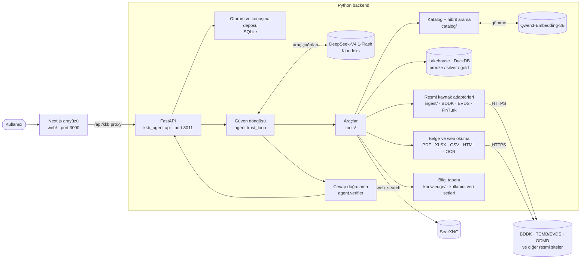
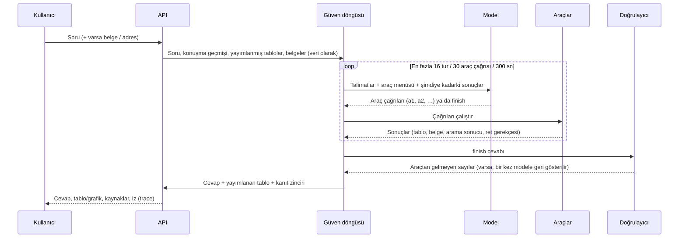
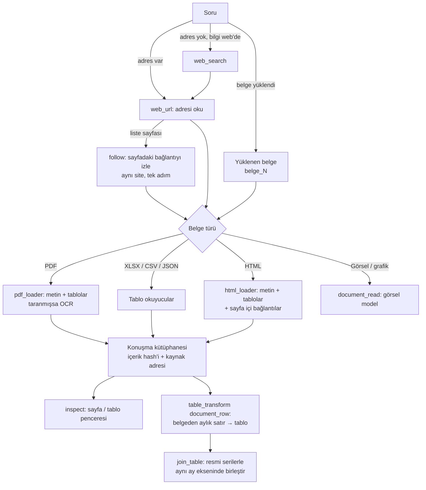
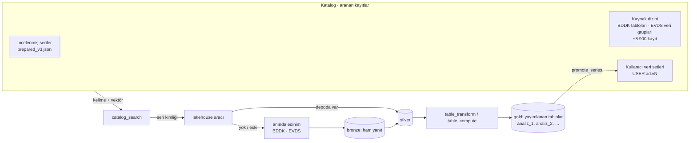

# DataTrio — KKB Agentic Data Analytics

Türkiye finans verileri (BDDK, TCMB/EVDS, TÜİK, web sayfaları ve yüklenen belgeler) üzerinde
Türkçe soruları cevaplayan, **model merkezli bir analiz ajanı**. Model hangi aracı ne zaman
çağıracağına kendisi karar verir; her sayı bir aracın okuduğu ya da hesapladığı değerden gelir
ve okuyucuya gitmeden önce doğrulanır.

- **Model:** Kloudeks üzerinden `deepseek-ai/DeepSeek-V4.1-Flash` (araç çağırma / tool calling)
- **Gömme (embedding):** `Qwen3-Embedding-8B` ile hibrit (kelime + anlam) katalog araması
- **Backend:** Python 3.12, FastAPI, DuckDB (bronze / silver / gold lakehouse)
- **Frontend:** Next.js (Node 22)

---

## İçindekiler

1. [Hızlı başlangıç (ilk kurulum)](#1-hızlı-başlangıç-ilk-kurulum)
2. [Genel mimari](#2-genel-mimari)
3. [Agentic karar alma ve görev işleme](#3-agentic-karar-alma-ve-görev-işleme)
4. [Doküman ve web okuma yaklaşımı](#4-doküman-ve-web-okuma-yaklaşımı)
5. [Modüler kod yapısı ve klasör ağacı](#5-modüler-kod-yapısı-ve-klasör-ağacı)
6. [Veri katmanı: katalog, lakehouse, bilgi tabanı](#6-veri-katmanı-katalog-lakehouse-bilgi-tabanı)
7. [Doğrulama ve güvenlik](#7-doğrulama-ve-güvenlik)
8. [Testler](#8-testler)

---

## 1. Hızlı başlangıç (ilk kurulum)

İki terminal kullanılır: biri Python API (8011), biri web arayüzü (3000). Aşağıdaki komutlar
macOS/Linux içindir; Windows PowerShell karşılıkları her adımın altında verilmiştir.

### 1.1 Gereksinimler

| Araç | Sürüm |
|---|---|
| Python | 3.12 |
| Node.js | 22 (`.node-version`: 22.23.2) |
| Git | herhangi güncel sürüm |
| Docker | yalnızca web araması (SearXNG) istenirse |

Kloudeks erişim bilgileri (API anahtarı) gereklidir; depoda bulunmaz.

### 1.2 Kodu al ve bağımlılıkları kur

```bash
git clone https://github.com/cagatayeroglu/KKB-DataTrio.git
cd KKB-DataTrio

python3.12 -m venv .venv
.venv/bin/python -m pip install -e '.[dev]'

cd web && npm ci --ignore-scripts --no-audit --no-fund && cd ..
```

Windows: `py -3.12 -m venv .venv` ve `.\.venv\Scripts\python.exe -m pip install -e ".[dev]"`.

### 1.3 Ortam dosyası (`.env`)

`.env.example` dosyasını `.env` olarak kopyalayıp Kloudeks bilgilerini girin:

```bash
cp .env.example .env
```

| Anahtar | Ne için |
|---|---|
| `KLOUDEKS_BASE_URL`, `KLOUDEKS_API_KEY` | Model sunucusu ve anahtar |
| `KLOUDEKS_PLANNER_MODEL` | Ajan modeli (`deepseek-ai/DeepSeek-V4.1-Flash`) |
| `KLOUDEKS_EMBEDDING_MODEL` | Anlamsal arama gömmesi (Qwen3-Embedding-8B) |
| `KLOUDEKS_OCR_MODEL`, `KLOUDEKS_VISION_MODEL` | Taranmış PDF / görsel okuma (isteğe bağlı) |

`.env` hiçbir zaman Git'e eklenmez.

### 1.4 Hazır veri havuzunu oluştur (bir kez, yaklaşık 2 dakika)

Depo resmi veri içermez. Ajanın hazır tuttuğu 29 seri (BDDK konut kredisi bakiyesi, EVDS kredi
faizleri, TÜFE ve alt grupları, konut fiyat endeksi) kaynaklardan bir kez indirilir. Diğer bütün
BDDK/EVDS serileri soru sorulduğunda kaynağından **anında** çekilir.

```bash
# BDDK Aylık Bülten — Tüketici Kredileri - Konut (TP, YP, Toplam)
.venv/bin/python -m kkb_agent.ingest.bddk_monthly_operator prepare \
  --root data/processed/lakehouse --start 2021-01 --end 2026-06 \
  --component TP --component YP --component TOTAL

# TCMB/EVDS — kredi faizleri, TÜFE (genel + 13 alt grup), konut fiyat endeksi
.venv/bin/python -m kkb_agent.ingest.evds_operator prepare \
  --root data/processed/lakehouse --start 2021-01-01 --end 2026-06-30 \
  --series TP.KTF10 --series TP.KTF101 --series TP.KTF11 --series TP.KTF12 \
  --series TP.KTF17 --series TP.KTF17.EUR --series TP.KTF17.USD --series TP.KTF18 \
  --series TP.KTFTUK --series TP.KTFTUK01 --series TP.KFE.TR --series TP.GENENDEKS.T1 \
  --series TP.TUKFIY2025.GENEL --series TP.TUKFIY2025.01 --series TP.TUKFIY2025.02 \
  --series TP.TUKFIY2025.03 --series TP.TUKFIY2025.04 --series TP.TUKFIY2025.05 \
  --series TP.TUKFIY2025.06 --series TP.TUKFIY2025.07 --series TP.TUKFIY2025.08 \
  --series TP.TUKFIY2025.09 --series TP.TUKFIY2025.10 --series TP.TUKFIY2025.11 \
  --series TP.TUKFIY2025.12 --series TP.TUKFIY2025.13
```

Kontrol (model çağrısı yapmaz):

```bash
.venv/bin/python -m kkb_agent.api --check \
  --prepared-root data/processed/lakehouse --catalog docs/catalog/prepared_v3.json --env-file .env
```

`"ready": true` ve `"prepared_identities": 29` görülmelidir.

### 1.5 (İsteğe bağlı) Anlamsal arama dizini

Anlamsal arama olmadan da sistem çalışır (kelime araması). Açmak için incelenmiş katalogun
vektörlerini bir kez üretin:

```bash
.venv/bin/python -m kkb_agent.catalog.embedding --catalog docs/catalog/prepared_v3.json \
  --root "$PWD/data/processed/catalog-index/reviewed" \
  --policy qwen3-instruct-query-v1 --env-file .env --enable-embedding-requests
```

İlk açılışta API, BDDK/EVDS kaynak dizinindeki yaklaşık 8.900 kaydın vektörlerini arka planda
tamamlar (bir kez, ~5 dakika) ve `--state-root` altında saklar. Sonraki açılışlarda yeniden
kullanılır; **state klasörünü silmeyin**, yoksa bu adım tekrarlanır.

### 1.6 (İsteğe bağlı) Web araması — SearXNG

```bash
mkdir -p data/processed/searxng
# settings.yml: use_default_settings: true; search.formats: [html, json];
#               server.secret_key: <rastgele>; server.limiter: false
docker run -d --name datatrio_searxng --restart unless-stopped -p 127.0.0.1:8888:8080 \
  -v "$PWD/data/processed/searxng/settings.yml:/etc/searxng/settings.yml:ro" searxng/searxng:latest
```

### 1.7 Çalıştır

**Terminal 1 — API (8011):**

```bash
PYTHONUTF8=1 PYTHONUNBUFFERED=1 PYTHONPATH="$PWD/src" .venv/bin/python -m kkb_agent.api --serve \
  --enable-model-requests --trust-loop --enable-web-url \
  --prepared-root data/processed/lakehouse \
  --catalog docs/catalog/prepared_v3.json \
  --env-file .env \
  --state-root data/processed/state \
  --port 8011 \
  --catalog-index "$PWD/data/processed/catalog-index/reviewed" \
  --searxng-url http://127.0.0.1:8888 --searxng-loopback
```

- `--catalog-index` satırı yalnızca 1.5 yapıldıysa, `--searxng-*` satırı yalnızca 1.6 yapıldıysa gerekir.
- `{"ready": true, ...}` satırı görünene kadar arayüzü açmayın.

**Terminal 2 — web arayüzü (3000):**

```bash
cd web
KKB_LOCAL_API_URL=http://127.0.0.1:8011 NEXT_TELEMETRY_DISABLED=1 npm run dev
```

Tarayıcıda **http://127.0.0.1:3000** açılır.

<details>
<summary>Windows PowerShell komutları</summary>

```powershell
# Terminal 1
$env:PYTHONUTF8='1'; $env:PYTHONUNBUFFERED='1'; $env:PYTHONPATH='src'
.\.venv\Scripts\python.exe -m kkb_agent.api --serve --enable-model-requests --trust-loop --enable-web-url `
  --prepared-root data\processed\lakehouse --catalog docs\catalog\prepared_v3.json --env-file .env `
  --state-root data\processed\state --port 8011

# Terminal 2
cd web
$env:KKB_LOCAL_API_URL='http://127.0.0.1:8011'; $env:NEXT_TELEMETRY_DISABLED='1'; npm run dev
```

</details>

**Sık karşılaşılanlar**

| Belirti | Çözüm |
|---|---|
| Sayfa "Analiz tamamlanamadı", `/api/kkb/...` 404 | `web/.next` klasörünü silip `npm run dev`'i yeniden başlatın |
| `/api/kkb/v1/health` 503 | API henüz hazır değil; `"ready": true` satırını bekleyin |
| `ConnectError: dns` | Kloudeks sunucusuna ağ erişimi yok; bağlantıyı kontrol edin |

---

## 2. Genel mimari



Bir sorunun yolculuğu:



---

## 3. Agentic karar alma ve görev işleme

Sistem **tek bir model güdümlü döngü** ile çalışır (`src/kkb_agent/agent/trust_loop.py`, API'de
`--trust-loop`). Sabit bir plan şablonu yoktur; model her turda elindeki sonuçlara bakıp bir
sonraki adıma karar verir.

**Döngü**

1. Modele sistem talimatları (`agent/trust_prompt.py`), araç menüsü, soru ve bağlam verilir.
   Konuşma geçmişi, yayımlanmış tablolar (`analiz_1`, …) ve belgeler (`belge_1`, …)
   **talimat değil veri** olarak gönderilir.
2. Model yerel araç çağırma (native tool calling) ile bir ya da birden çok araç ister. Her
   sonuca sistem bir kimlik verir (`a1`, `a2`, …); sonraki çağrılar sonuçlara bu kimlikle
   başvurur.
3. Araç reddederse gerekçe modele döner (ör. "bu sütun tabloda yok; sütunlar şunlar"). Ret,
   turun sonu değil, bir bilgidir; model parametreyi düzeltir ya da başka araç seçer.
4. Model yeterli kanıtı topladığında `finish(answer, publish)` çağırır.

**Araçlar**

| Araç | Görev |
|---|---|
| `catalog_search` | Katalogda (incelenmiş seriler + BDDK/EVDS kaynak dizini + kullanıcı veri setleri) kelime + anlam araması |
| `lakehouse` | Seri okuma; depoda yoksa ya da güncel değilse resmi kaynaktan anında çekme |
| `table_transform` | Değişim (fark / yüzde), deflate, yeniden bazlama, frekans dönüşümü, tablo birleştirme, filtre, belge satırı alma |
| `table_compute` | Sütun toplamı / farkı gibi deterministik tablo hesapları |
| `change_detection`, `anomaly`, `causality` | Dönem karşılaştırma, aykırı değer, öncelik (Granger) analizleri |
| `inspect` | Bir tablonun ya da belgenin istenen penceresini okumak |
| `web_url` | Soruda verilen adresi okumak, sayfadaki bağlantıyı izlemek (PDF, XLSX, CSV, JSON, HTML) |
| `web_search` | Web araması (SearXNG) |
| `document_read` | Tablo içermeyen belge / görsel / taranmış sayfa okuma (OCR, görsel model) |
| `promote_series` | Bir belge sütununu ya da konuşmadaki bir tabloyu bilgi tabanına kalıcı kaydetmek |

**Karar ilkeleri** (talimatlarda, katı harness kuralı olarak değil)

- **Rakamı model üretmez.** Her sayı bir aracın okuduğu ya da hesapladığı değerdir. Fark, oran,
  en yüksek/en düşük gibi karşılaştırmalar da bir araçla hesaplanır.
- Soruda adres varsa önce o okunur; arama ancak yetmezse yapılır.
- Değişim hesabı için gereken önceki dönem de okunur (Ocak değişimi için Aralık).
- Bir bakiye serisinde "stok olmasın / o ayın" denirse ölçü bir önceki aya göre **net
  değişimdir**; "yeni kullandırım" diye adlandırılmaz.
- Belirsizlikte model makul bir varsayım seçip tek cümleyle belirtir; gerçekten anlaşılmıyorsa
  `ask` ile sorar.

**Bütçe ve kurtarma**

- Tur başına sayaçlar: 16 tur, 30 araç çağrısı, 300 saniye. Sayaç dolarsa model son
  sonuçları görerek bir kez daha cevap yazar.
- Bir tur yalnızca düşünmeyle bütçesini bitirirse model bir kez daha kısa kararla sorulur.
- Cevaptaki bir sayı hiçbir araç sonucunda yoksa `finish` bir kez modele geri döner: "hesapla
  ya da çıkar". Model aynı cevabı verirse cevap gider, sayı okuyucuya "doğrulanamadı" diye
  işaretlenir.

---

## 4. Doküman ve web okuma yaklaşımı



- **Okunan her belge** içerik hash'i, kaynak adresi ve okunma zamanıyla konuşmanın
  kütüphanesine alınır; aynı konuşmada ve yeniden başlatmadan sonra adıyla (`belge_1`) açılır.
- **Tipli çıkarım ile model okuması ayrıdır:** tablo hücreleri deterministik okuyucularla
  sayıya çevrilir (hücre konumu kanıt olarak saklanır); tablo olmayan içerik `document_read`
  ile modele okutulur ve çıktısı hesaplamaya girmez, alıntı olarak işaretlenir.
- **Belgenin içindeki metin talimat değildir.** Bir sayfada "şu adresi aç" yazması yeni bir
  istek yetkisi vermez; yalnızca soruda yazan adres ve aynı sitedeki tek adımlık bağlantı izlenir.
- **Güvenli getirme:** DNS / IP / TLS kontrolü, yerel ağ adreslerine erişim yasağı, boyut ve
  süre sınırları ayrı bir işçi süreçte uygulanır (`ingest/_fetch_worker.py`, `safe_fetch.py`).

---

## 5. Modüler kod yapısı ve klasör ağacı

```text
KKB-DataTrio/
├── README.md                  # Bu dosya
├── AGENTS.md                  # Geliştirici / kodlama ajanı çalışma kuralları
├── Makefile                   # make install-dev · make quick · make pr (kontroller)
├── pyproject.toml             # Python paketi ve bağımlılıklar
├── .env.example               # Ortam değişkenleri şablonu (gerçek .env Git'e girmez)
│
├── src/kkb_agent/             # Python backend
│   ├── agent/                 # Ajan: güven döngüsü, talimatlar, cevap yazımı, doğrulayıcı
│   │   ├── trust_loop.py      #   Model güdümlü araç döngüsü, bütçeler, kurtarma
│   │   ├── trust_prompt.py    #   Sistem talimatları (tüm davranış kuralları burada)
│   │   ├── trust_session.py   #   Bir sorunun uçtan uca işlenmesi, konuşma hafızası
│   │   ├── trust_answer.py    #   Cevabın kontrolü, uyarılar, yayımlanacak tablo
│   │   ├── verifier.py        #   Sayı bağlama: her sayı bir araç sonucuna bağlanır
│   │   └── registry.py        #   Araç kayıt defteri
│   ├── tools/                 # Modelin çağırdığı araçlar (catalog_search, lakehouse,
│   │                          #   table_transform, web_url, promote_series, …)
│   ├── analytics/             # Deterministik finansal hesaplar (değişim, deflasyon,
│   │                          #   frekans dönüşümü, anomali, nedensellik testleri)
│   ├── catalog/               # İncelenmiş katalog, kaynak dizini, hibrit arama, gömme dizini
│   ├── ingest/                # Resmi kaynak adaptörleri (BDDK aylık/haftalık/FinTürk, EVDS),
│   │                          #   anında veri çekme, güvenli HTTPS işçisi
│   ├── lakehouse/             # DuckDB depo: bronze (ham), silver (seri), gold (tablo), soy kütüğü
│   ├── knowledge/             # Kullanıcı bilgi tabanı: sürümlü veri setleri, notlar, katalog katmanı
│   ├── api/                   # FastAPI uygulaması, oturumlar, bilgi tabanı servisi, API sözleşmeleri
│   ├── llm/                   # Kloudeks istemcisi (sohbet, araç çağırma, gömme, OCR, görsel)
│   ├── core/                  # Ortak veri sözleşmeleri (seri, sonuç, dönem, birim)
│   ├── evaluation/            # Değerlendirme yardımcıları
│   └── *_loader.py, pdf_ocr.py# PDF / XLSX / CSV / HTML / görsel okuyucular, OCR
│
├── web/                       # Next.js arayüzü
│   ├── app/                   #   Sayfa ve /api/kkb proxy rotası
│   ├── components/            #   Sohbet, tablo, grafik, kanıt zinciri, bilgi tabanı, iz ekranı
│   └── lib/                   #   API istemcisi, sözleşmeler (zod), grafik ve tablo mantığı
│
├── docs/                      # Ayrıntılı tasarım belgeleri
│   ├── catalog/prepared_v3.json   # İncelenmiş katalog (29 hazır + 37 kimlik)
│   ├── ARCHITECTURE.md, CATALOG.md, DATABASE.md, SECURITY.md
│   ├── BDDK_*.md, EVDS_*.md   #   Kaynak envanterleri ve hazırlama sözleşmeleri
│   └── OPERATIONS.md          #   Ayrıntılı işletim rehberi
│
├── tests/unit/                # Birim ve regresyon testleri (canlı ağa çıkmaz)
├── scripts/                   # Gizli anahtar taraması ve yardımcı betikler
└── data/processed/            # (Git'te yok) hazır havuz, state, gömme dizinleri
```

**Katman sınırları**

- **Model karar verir, kod hesaplar.** Finansal hesapların tamamı `analytics/` ve `tools/`
  içindeki deterministik kodda yapılır; model yalnızca hangi aracın hangi parametreyle
  çağrılacağını seçer.
- **Araçlar birbirinden bağımsızdır:** her araç kendi argüman şemasını (`pydantic`) ve ret
  gerekçelerini taşır; `agent/registry.py` üzerinden menüye eklenir. Konuşmada belge ya da
  bilgi tabanı olduğunda ilgili araçlar tur içinde menüye katılır.
- **Kaynak adaptörleri tek bir sözleşmeye uyar:** getirme → bronze'a ham yanıt → ayrıştırma
  → silver'a seri + soy kütüğü. Yeni kaynak eklemek için bkz. `docs/ADDING_A_SOURCE.md`.

---

## 6. Veri katmanı: katalog, lakehouse, bilgi tabanı



- **Katalog** neyin var olduğunu söyler, veriyi taşımaz. Anlamsal arama dizini değişmeyen
  vektörleri yeniden kullanır; yeni bir kayıt eklendiğinde yalnız o kayıt gömülür.
- **Lakehouse** (DuckDB): bronze kaynaktan gelen ham yanıtı hash'iyle, silver doğrulanmış seriyi,
  gold yayımlanan tabloları tutar; her adım soy kütüğüne (lineage) yazılır.
- **Güncellik:** BDDK aylık bülteni yayımlandıkça yeni aylar çekilir; saklanan geçmiş aylar
  değişmeden kalıyorsa seri uzatılır, revize edilmiş bir ay sürüm çakışması sayılır.
- **Bilgi tabanı:** kullanıcı bir belgeyi ya da konuşmadaki bir tabloyu "kaydet" dediğinde
  sürümlü bir veri seti (`USER:<ad>.v1`) oluşur; kaynak adresi, okunma zamanı ve içerik hash'i
  kökeniyle birlikte saklanır ve sonraki konuşmalarda aranıp okunabilir.

---

## 7. Doğrulama ve güvenlik

- **Sayı doğrulama:** cevaptaki her sayı bir araç sonucuna, dönemine ve birimine bağlanır.
  Bağlanamayan sayı okuyucuya ayrıca bildirilir; belgeden aynen alıntılanan sayı "alıntı"
  olarak sayfa numarasıyla işaretlenir.
- **Kanıt zinciri:** her yayımlanan tablo hangi kaynaktan, hangi dönüşümlerle üretildiğini
  taşır; arayüzde "kanıt zinciri" ve "iz" (trace) ekranlarında görülür.
- **Dış içerik güvenilmezdir:** sayfa, belge ve arama sonucu metni talimat olarak işlenmez.
- **Gizli bilgiler:** `.env` ve anahtarlar Git'e girmez (`scripts/check_secrets.py`); cevapta
  kanıtı olmayan adresler gösterilmez.

---

## 8. Testler

```bash
make quick   # ruff + birim testler
make pr      # biçim, lint, mypy, birim testler, bandit, gizli anahtar taraması
```

Birim testler ağa çıkmaz; kaynak yanıtları ve model cevapları testlerde sahte (injected)
sağlanır. Ayrıntılı tasarım kararları: `docs/DECISIONS.md`; işletim rehberi: `docs/OPERATIONS.md`.
