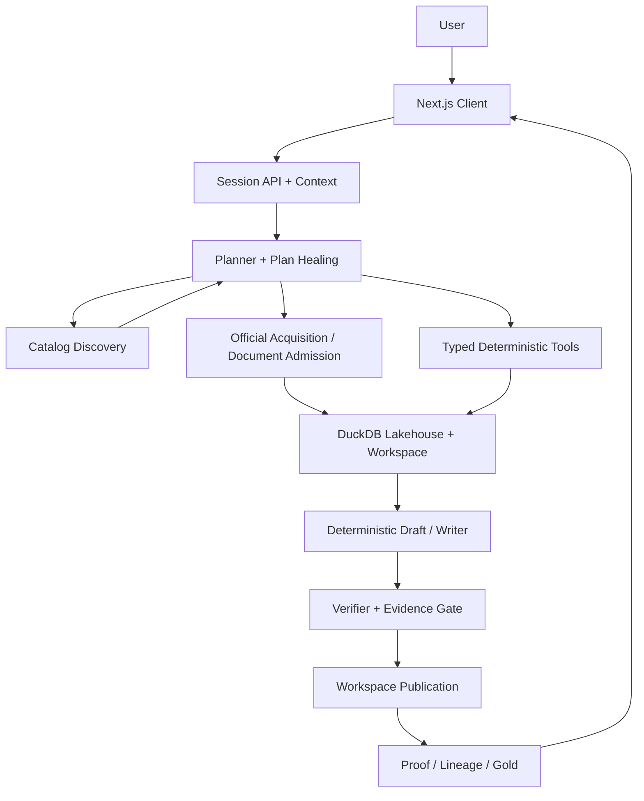
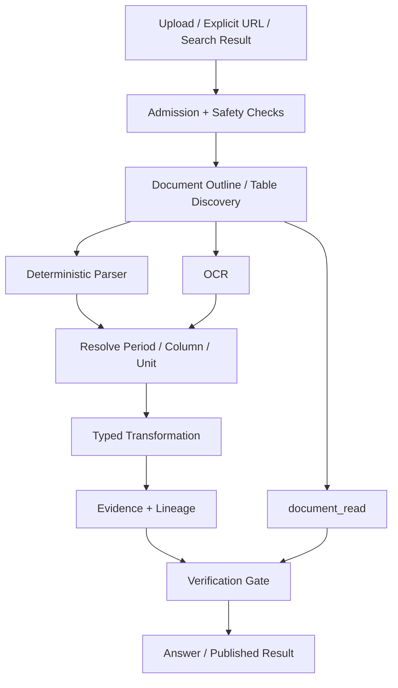
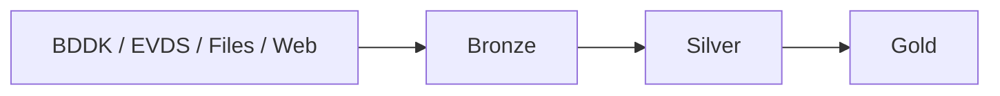

# KKB Agentic Analytics — DataTrio

**DataTrio** is an evidence-backed, agentic financial-data analyst developed for the **KKB Agentic Data Analytics Hackathon**.

Its core design principle is:

> **The LLM decides what to do; deterministic code performs material financial calculations; verification decides what may be shown.**

The model interprets the user's intent, discovers the required data, plans the analysis and explains verified results.  
Python/DuckDB tools perform calculations and transformations. Published results retain source, period, transformation and verification evidence so that users can inspect how a number was produced.

---

## Overview

DataTrio is a stateful financial-analysis workspace for Turkish banking and macroeconomic data.

It combines:

- **BDDK Monthly Bulletin**
- **BDDK Weekly Bulletin**
- supported **FinTürk** source-directory data
- **TCMB / EVDS** time series
- user-provided **CSV, XLSX, PDF and image** files
- **OCR** for scanned documents and images
- explicit **web search**
- explicit **web URL reading**
- deterministic financial transformations
- statistical analysis tools
- persistent multi-turn analytical conversations
- a versioned user knowledge layer
- evidence, lineage and execution traces

The application consists of:

- a Python backend/API,
- a DuckDB-backed analytical workspace,
- a local Next.js frontend,
- a financial-data catalog and retrieval layer,
- deterministic analysis tools,
- an evidence and verification layer.

---

# System Architecture

DataTrio deliberately separates:

1. **reasoning**
2. **data discovery**
3. **data acquisition**
4. **calculation**
5. **verification**
6. **presentation**



The effective runtime flow is:

```text
User
→ session/context assembly
→ planner / plan healing
→ catalog discovery when required
→ official acquisition or document/web admission when required
→ typed deterministic tools
→ workspace result
→ deterministic draft or writer
→ numeric/evidence verification
→ workspace publication
→ proof / lineage projection
→ optional Gold materialization
→ User
```

---

## Architectural Principles

### 1. LLM for decisions, deterministic code for calculations

The LLM is responsible for:

- understanding intent,
- deciding which data is needed,
- selecting tools,
- planning dependencies,
- asking clarification when required,
- explaining verified results.

The LLM is **not trusted to perform material financial calculations**.

Calculations are performed by deterministic Python/DuckDB tools.

---

### 2. Facts are strict

Financial claims must remain consistent with the underlying analytical result.

The verification layer can validate attributes such as:

- numeric value,
- period,
- unit,
- scale,
- series identity,
- source,
- transformation,
- execution evidence,
- lineage.

---

### 3. Interpretation is separated from computation

A writer may provide:

- readable Turkish explanations,
- financial interpretation,
- caveats,
- explanations of analytical results.

However, it may not:

- invent new figures,
- change a series,
- invent a source,
- change the period,
- change the unit,
- contradict deterministic results,
- present correlation or Granger results as proven causality.

---

### 4. External content is untrusted

The following are treated as **data**, not instructions:

- uploaded documents,
- web pages,
- catalog metadata,
- external source text,
- model-generated content.

This boundary is important for prompt-injection resistance and reproducible analytical behavior.

---

### 5. Unknown semantics stay explicit

DataTrio does not silently guess:

- units,
- scales,
- frequencies,
- stock/flow meaning,
- cumulative reset behavior,
- missing values,
- unsupported source semantics.

If the system cannot resolve a required semantic safely, it can clarify or abstain.

---

# Modular Code Structure

The repository is divided into modules with explicit responsibilities.

```text
KKB-DataTrio/
│
├── src/
│   └── kkb_agent/
│       ├── agent/
│       ├── analytics/
│       ├── api/
│       ├── catalog/
│       ├── core/
│       ├── ingest/
│       ├── knowledge/
│       ├── lakehouse/
│       ├── llm/
│       └── tools/
│
├── web/
├── tests/
├── docs/
├── scripts/
├── .github/
├── Makefile
├── pyproject.toml
└── README.md
```

| Module | Responsibility |
|---|---|
| `src/kkb_agent/api/` | API, sessions, conversations, health/readiness, result projection and knowledge endpoints |
| `src/kkb_agent/agent/` | Planner loop, validation, plan healing, continuation, execution, writer and verifier |
| `src/kkb_agent/tools/` | Typed analytical tool interfaces |
| `src/kkb_agent/analytics/` | Deterministic financial/statistical calculations |
| `src/kkb_agent/ingest/` | Official acquisition, document ingestion, safe fetching and source handling |
| `src/kkb_agent/catalog/` | Catalog identities, normalization, lexical search and dense retrieval |
| `src/kkb_agent/lakehouse/` | Typed analytical results, evidence and analytical storage integration |
| `src/kkb_agent/knowledge/` | User-added datasets, versions and knowledge-base lifecycle |
| `src/kkb_agent/llm/` | Kloudeks model boundary, structured output and repair/retry |
| `src/kkb_agent/core/` | Shared result/contracts/primitives |
| `web/` | Next.js analytical workspace |
| `tests/unit/` | Unit, contract, security and regression tests |
| `docs/` | Architecture, source, decision, security, evaluation and operation documents |

This separation ensures that:

- the planner does not implement data adapters,
- the writer does not calculate financial values,
- the frontend does not calculate financial values,
- source acquisition does not directly bypass verification,
- new supported financial sources can reuse the shared analytical core.

---

# Agentic Decision-Making and Task Processing

DataTrio uses a **custom bounded agent loop** rather than an unrestricted autonomous-agent framework.

## Planner

The planner receives bounded context containing information such as:

- the current user question,
- recent conversation turns,
- available tools,
- previously published result metadata,
- catalog candidates,
- document references.

It decides:

- which financial measures are requested,
- which source/series is needed,
- whether discovery is required,
- whether official acquisition is required,
- which tools should execute,
- execution dependencies,
- whether clarification is necessary.

The planner never needs to manufacture financial values.

---

## Typed Analytical Plans

The model must produce a typed plan rather than arbitrary executable instructions.

A plan step contains concepts such as:

```json
{
  "step_id": "read_credit",
  "tool": "lakehouse",
  "arguments": {
    "series": ["SERIES_ID"],
    "start": "2025-01-01",
    "end": "2025-12-31"
  }
}
```

Before execution, the harness checks:

- tool identity,
- argument schema,
- dependencies,
- step identity,
- supported operation,
- execution budgets.

Invalid plans can be rejected or repaired within a bounded repair budget.

A model response does not become executable merely because the model generated it.

---

## Plan Healing

Safe structural issues can be corrected by the orchestration layer.

Examples include bounded corrections involving:

- missing dependencies,
- references to previous result identities,
- certain series/step identity formatting issues.

Plan healing is not permission to alter the user's requested financial meaning.

---

## Catalog Discovery

The planner does not need to know every official series ID in advance.

`catalog_search` can search:

- reviewed canonical series,
- BDDK source-directory records,
- EVDS source-directory records,
- user-added datasets.

Retrieval can operate as:

```text
lexical search
        +
local dense retrieval
        ↓
hybrid catalog results
```

Dense catalog retrieval uses a local vector index.

Financial observations themselves are **not stored in LanceDB**.

---

## Official Acquisition

A source-directory series can be known to the catalog without already existing in the local lakehouse.

For supported official sources:

```text
catalog identity
→ typed lakehouse request
→ local observation missing
→ official BDDK / EVDS adapter
→ fetch
→ normalize
→ persist
→ typed result
```

This allows DataTrio to expand beyond the initially prepared series while preserving a reviewed acquisition boundary.

---

# Tool Architecture

The current analytical architecture contains tools including:

- `catalog_search`
- `lakehouse`
- `table_transform`
- `change_detection`
- `anomaly`
- `causality`
- `web_search`
- `web_url`
- `document_read`
- `promote_series`

---

## Lakehouse

`lakehouse` reads normalized financial observations.

For a known catalog identity it can retrieve typed series data with:

- period,
- value,
- unit,
- scale,
- frequency,
- stock/flow semantics.

The planner can request a known series without writing its own SQL.

A restricted read-only SQL path exists for analytical selections that cannot be represented by the simpler typed read contract.

---

## Table Transform

`table_transform` performs deterministic operations on analytical tables.

Supported transformation concepts include:

- joining tables,
- aligning periods,
- filtering periods,
- resampling,
- deflation,
- rebasing,
- period-over-period change,
- cumulative-to-flow conversion,
- combining compatible columns,
- summary statistics,
- adding an official series,
- adding a document column.

---

## Change Detection

Change analysis supports operations such as:

- direct period comparison,
- co-movement,
- breakpoint detection,
- table-column co-movement.

---

## Anomaly Detection

The anomaly tool detects periods whose movement differs materially from typical behavior.

It uses deterministic robust-statistical logic rather than asking the LLM to decide which points "look unusual."

---

## Causality / Predictive Precedence

The causality tool supports:

- association,
- lagged association,
- Granger-style analysis.

A Granger result is explicitly treated as:

> **predictive precedence, not proof of causality**

---

# Document Reading and Agent Structure

Document handling is deliberately separated into:

1. admission,
2. extraction,
3. interpretation,
4. analytical transformation,
5. evidence verification.



---

## Supported Inputs

DataTrio supports bounded processing for:

- CSV
- XLSX
- PDF
- scanned PDF
- PNG
- JPG
- explicit HTTPS URLs
- pages discovered through configured web search

Conversation uploads are registered into a conversation document library.

---

## Typed Extraction vs Model Reading

Two concepts are intentionally different.

### Typed extraction

Used when a value must become part of a verifiable analytical table.

For example:

```text
XLSX
→ identify monthly table
→ bind period column
→ bind financial value column
→ establish unit
→ create typed values
→ deterministic transform
```

### `document_read`

Used for model-assisted understanding or summarization.

A model's reading of a PDF is not automatically treated as a trusted financial calculation.

If document values will be used in calculations, they must pass through the typed analytical/evidence path.

---

## OCR

OCR is available when the configured Kloudeks OCR model is enabled.

It supports use cases such as:

- scanned PDFs,
- screenshots,
- image-based financial tables.

The system follows a conservative rule:

> **Unreadable values remain missing instead of being guessed.**

---

# Web Search and URL Reading

Web discovery and URL reading are separate capabilities.

## `web_search`

Uses a configured local SearXNG instance.

Search results are treated as:

> **candidate sources, not verified financial evidence**

---

## `web_url`

Reads explicitly authorized URLs through the safe-fetch boundary.

The fetching path includes controls around:

- allowed network requests,
- DNS/address handling,
- redirects,
- response size,
- document parsing.

Fetched page content remains untrusted data.

---

# Data Architecture — Bronze, Silver and Gold

DataTrio follows a medallion-style analytical architecture.



---

## Bronze

Contains admitted/raw source-level artifacts and source evidence.

Goal:

> preserve what was actually received from the source.

---

## Silver

Contains normalized, typed financial series and observations.

A usable Silver series records semantics such as:

- series identity,
- unit,
- scale,
- frequency,
- observation type,
- accumulation behavior,
- source/provider information.

---

## Gold

Contains eligible verified analytical results together with lineage/evidence.

A result being visible in a conversation and a result being Gold-materialized are related but not identical guarantees.

Gold materialization also depends on result shape and lineage requirements.

---

# Catalog vs Lakehouse

These are intentionally different systems.

## Catalog

Answers:

> **What data exists and what does it mean?**

Contains information such as:

- title,
- identity,
- aliases,
- frequency,
- unit,
- provider,
- source-directory metadata.

---

## Lakehouse

Answers:

> **What are the actual normalized observations?**

Contains financial values used by deterministic analytical tools.

---

# User Knowledge Base

DataTrio contains a versioned user knowledge layer.

A supported user table can be proposed for promotion into the knowledge base.

Persistence requires explicit user confirmation.

Saved datasets receive identities of the form:

```text
USER:<slug>.vN
```

After saving, a user dataset can:

- participate in catalog discovery,
- be found in later conversations,
- be used by analytical tools,
- coexist with reviewed official data.

Lexical discovery can be available immediately.

Dense semantic coverage is refreshed through the vector-index lifecycle.

---

# Stateful Multi-Turn Analysis

DataTrio is not a stateless question-answer system.

Published analytical results are stored as workspace artifacts.

Later turns can reference earlier results to perform operations such as:

```text
"Add the housing price index to the previous table."

"Convert the credit balance into real terms."

"Show only 2024."

"Run anomaly detection on that column."

"Compare the real credit series with the interest rate."
```

The planner receives bounded artifact metadata rather than being allowed to reconstruct previous financial values from memory.

---

# Verification, Evidence and Lineage

A major DataTrio design goal is being able to answer:

> **Where did this number come from?**

A normal execution trace may include events such as:

```text
planner.initial
→ catalog_search
→ lakehouse
→ acquisition.acquired
→ table_transform
→ writer / deterministic draft
→ answer.gate
→ workspace.published
→ gold.materialized
```

Depending on the analysis, evidence may include:

- source identity,
- series identity,
- period,
- unit,
- scale,
- transformations,
- tool execution,
- lineage references.

The frontend exposes these under **İşlem kayıtları** and related proof/evidence views.

---

# Writer and Presentation Layer

DataTrio retains a writer layer because a table alone is not always enough for financial analysis.

The writer may produce:

- readable explanation,
- contextual interpretation,
- caveats,
- interpretation of deterministic analytical findings.

The writer may not:

- invent numbers,
- change values,
- select another financial series,
- invent sources,
- reinterpret units,
- contradict tool output.

For canonical/simple result shapes, DataTrio can use a deterministic draft instead of invoking the writer.

---

# Financial Correctness Rules

Examples of explicit semantic rules include:

```text
stock → period movement
    = change(kind="difference")

cumulative series → period flow
    = to_flow

weekly series → monthly analysis
    = resample first

nominal currency → real value
    = deflate with explicit price index

index → new reference base
    = rebase
```

The system avoids silently substituting another operation when the requested operation is semantically invalid.

---

# Clarification and Abstention

When a request cannot be safely resolved, DataTrio can:

- request clarification,
- report missing data,
- report unsupported semantics,
- abstain.

This is intentional.

For financial analysis:

> **An explicit limitation is better than a fabricated answer.**

---

# Security and Trust Boundaries

DataTrio treats the following as untrusted:

- model output,
- source text,
- web content,
- uploaded documents,
- external metadata.

Security mechanisms include:

- typed structured-output validation,
- bounded planner execution,
- safe file admission,
- parser/resource limits,
- restricted analytical SQL,
- web-fetch controls,
- secret scanning,
- explicit source authority,
- explicit financial semantics.

For details, see:

[`docs/SECURITY.md`](docs/SECURITY.md)

---

# Frontend

The Next.js client exposes:

- chat-based financial analysis,
- result tables,
- charts,
- CSV / Excel export,
- conversation history,
- conversation archive/delete,
- knowledge-base management,
- model/settings controls,
- run status,
- stop/cancel controls,
- execution traces,
- evidence/proof inspection.

Financial calculations are performed in the backend, not in the browser.

---

# Observability

DataTrio provides unusually detailed execution visibility for an analytical assistant.

The **İşlem kayıtları** interface can expose events such as:

- planner calls,
- catalog searches,
- tool executions,
- acquisition,
- model calls,
- model latency,
- token information,
- writer execution,
- verification,
- publication state.

This allows the team and reviewers to inspect what the agent actually did instead of evaluating only the final prose.

---

# Why DataTrio Is Different

DataTrio is not simply:

```text
User → LLM → answer
```

It uses:

```text
User
→ bounded planner
→ semantic catalog
→ official acquisition
→ typed deterministic tools
→ analytical lakehouse
→ evidence / lineage
→ verifier
→ presentation
→ published artifact
```

Key distinguishing characteristics include:

### Deterministic financial computation

The model does not directly calculate material financial results.

### Evidence-backed answers

Results retain source, transformation and execution evidence.

### On-demand official acquisition

Supported official BDDK/EVDS series can be acquired when first needed.

### Hybrid financial catalog

Lexical and optional local dense retrieval are used for semantic series discovery.

### Stateful analytical artifacts

Follow-up questions operate over published tables rather than model memory.

### Versioned user knowledge

User-provided datasets can become reusable analytical series after explicit confirmation.

### Document + web analysis

CSV, XLSX, PDF, OCR images and web content can participate in the analytical workflow.

### Verification before publication

Tool output and prose pass through explicit correctness/evidence boundaries.

### Full execution trace

Planner, tools, acquisition, writer and publication events are inspectable.

---

# Runtime Configuration

Runtime LLM access uses the hackathon Kloudeks environment.

Optional capabilities include:

| Flag | Capability |
|---|---|
| `--enable-web-url` | Enable supported URL/document reading |
| `--searxng-url URL` | Register web search through local SearXNG |
| `--no-official-acquisition` | Disable supported BDDK/EVDS on-demand acquisition |
| `--no-uploads` | Disable file uploads |
| `--no-ocr` | Disable OCR |

Runtime health reports enabled capabilities rather than assuming they exist.

---

# Development

Start with:

[`AGENTS.md`](AGENTS.md)

and the current handoff in:

[`docs/ROADMAP.md`](docs/ROADMAP.md)

Development setup:

```bash
make install-dev
make quick
```

For the full local application, follow:

[`docs/OPERATIONS.md`](docs/OPERATIONS.md)

Backend and frontend run separately.

The client is normally available at:

```text
http://127.0.0.1:3000/
```

A fresh checkout contains no private credentials or prepared official data.

Never commit:

- `.env` secrets,
- credentials,
- private/downloaded data,
- generated prepared-state directories.

---

# Validation Strategy

DataTrio uses several validation layers:

- targeted unit tests,
- regression tests,
- strict type checking,
- formatting/lint checks,
- Bandit security checks,
- secret scanning,
- broad PR gates,
- scripted/offline acceptance,
- live acceptance.

A green automated test suite is necessary but is not considered sufficient proof for model/source-dependent behavior such as:

- planning,
- web search,
- web URL navigation,
- official acquisition,
- OCR,
- multi-turn orchestration.

Those behaviors are additionally validated through explicit live acceptance scenarios.

---

# Documentation

| Document | Responsibility |
|---|---|
| [`README.md`](README.md) | Product overview, architecture and module structure |
| [`AGENTS.md`](AGENTS.md) | Engineering workflow and task lifecycle |
| [`docs/ARCHITECTURE.md`](docs/ARCHITECTURE.md) | Detailed runtime architecture and contracts |
| [`docs/ROADMAP.md`](docs/ROADMAP.md) | Current status, handoffs and remaining work |
| [`docs/DECISIONS.md`](docs/DECISIONS.md) | Architectural decisions and rationale |
| [`docs/DATABASE.md`](docs/DATABASE.md) | Storage schema and invariants |
| [`docs/SOURCES.md`](docs/SOURCES.md) | BDDK/EVDS source semantics and acquisition |
| [`docs/CATALOG.md`](docs/CATALOG.md) | Catalog/retrieval contracts |
| [`docs/OPERATIONS.md`](docs/OPERATIONS.md) | Setup, startup and recovery |
| [`docs/SECURITY.md`](docs/SECURITY.md) | Security and trust boundaries |
| [`docs/EVALUATION.md`](docs/EVALUATION.md) | Testing and acceptance evidence |

---

# Hackathon Documentation Checklist

The README explicitly documents all requested areas:

- [x] **Project modular code structure**
- [x] **Document-reading approach / agent structure**
- [x] **Agentic architecture decision-making and task-processing design**
- [x] **General architecture with diagrams and execution flows**

For implementation-level detail, see the linked architecture, source, security and evaluation documents.
